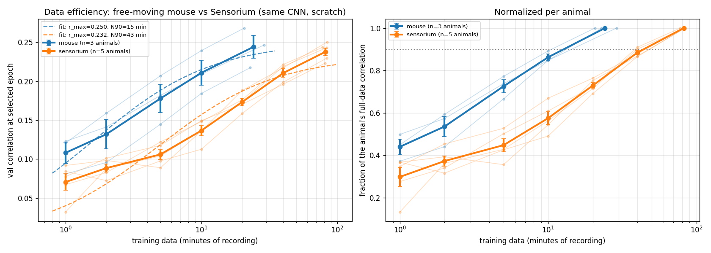
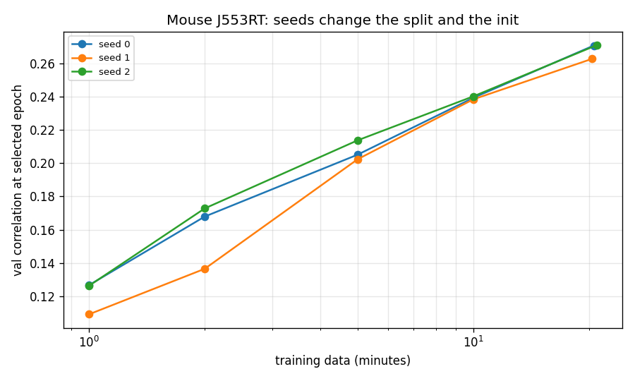
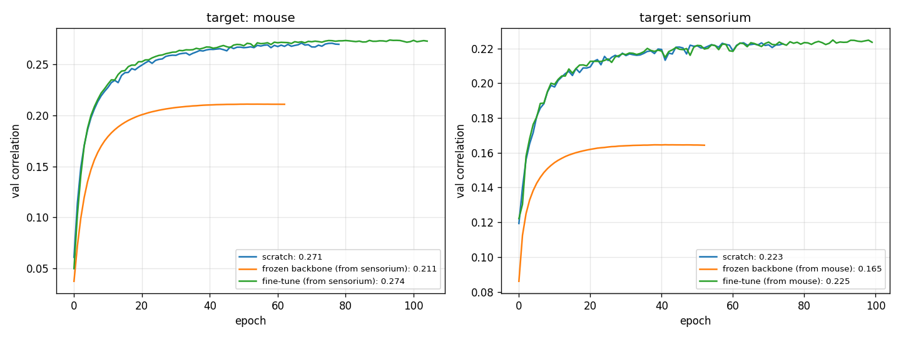

# Free-moving mouse (Xu 2023) vs head-fixed Sensorium: data efficiency of one CNN

Status as of 2026-11-20. This file summarizes the scratch learning-curve sweep, the replication across animals and seeds, and the transfer runs. All numbers come from the run folders in `runs/` (config, metrics and summary are committed) and from `research/sensorium_rescore_real_trials.json`.

> **Read this first: the Sensorium numbers are contaminated.** In the five Sensorium 2023 competition sessions used here, every `live_test_*` and `final_test_*` trial has its responses withheld; on disk they are exactly zero. The Sensorium cache and `sensorium_trial_split` use all trials, so 41-44% of every full-data Sensorium training set (34-69% of the smaller subsets) and 39-46% of every validation set are frames whose target is zero. The Sensorium models were therefore trained partly on fake silence, the "minutes" axis overstates real training data by about 1.8x, and the stored validation correlations are measured on a mixed set. Section 5.2 re-scores the existing checkpoints on real-response validation trials only, which lowers the across-session means by 0.04-0.05 at every training size. A clean comparison needs the Sensorium runs retrained on `train` and `oracle` trials only (section 9). The mouse numbers are not affected.

## 1. Question

Does a visual CNN fit to a freely moving mouse's head-camera video reach good neural predictivity with less data than the same CNN fit to head-fixed mice watching movies (Sensorium 2023)? We measure validation correlation as a function of minutes of training data, per animal, using one fixed architecture and training recipe for both datasets.

## 2. Naming glossary

| Name in code and run folders | Meaning |
|---|---|
| `mouse` | Xu et al. 2023 free-moving mouse V1 recordings (head-mounted camera video, single units). |
| `sensorium` | Sensorium 2023 dynamic (video) dataset, head-fixed mice, two-photon calcium imaging. |
| session (mouse) | `070921_J553RT`, `101521_J559NC`, `110421_J569LT`: one recording each from three different mice. `J553RT` is the default animal. |
| session (Sensorium) | `dynamic<animal>-<session>-<scan>-Video-<hash>`, for example `dynamic29515-10-12` is animal 29515, session 10, scan 12. `29515` is the default session. |
| `from_scratch` | All weights randomly initialized. |
| `transfer_frozen_backbone` | Backbone copied from the other dataset's full-data scratch run and frozen; only the readout trains. |
| `transfer_finetune` | Backbone copied as above, then everything trains. |
| `full` / `train_minutes_requested = None` | All training data of that one session under our split. It never means several sessions pooled. |

The name `mouse` is ambiguous because both datasets are mice. We recommend renaming it later to something like `xu_freemoving` (or `arena`) versus `sensorium`. We have not renamed anything yet, because run configs, `load_runs` filters and both notebooks key on `dataset == "mouse"`, and a rename should migrate all of them at once.

Run folders from the first sweep on the default animals are named without a session tag (for example `runs/20261118-234524_sensorium_from_scratch_full_s0`). Later runs include it (for example `runs/20261120-105646_sensorium_dynamic29623_from_scratch_full_s0`). The `session` field in every `config.json` is authoritative.

## 3. Setup

### 3.1 Data and splits

| | Xu free-moving mouse | Sensorium 2023 (5 competition sessions) |
|---|---|---|
| Animals used | 3 (J553RT, J559NC, J569LT) | 5 (29515, 29623, 29647, 29712, 29755) |
| Neurons per animal | 68, 49, 32 (108, 63, 52 recorded; units under 3 Hz dropped) | 7,863, 7,908, 8,202, 7,939, 8,122 |
| Sample rate | 48 ms bins (20.8 Hz) | 30 Hz video frames, one response bin per frame |
| Video | Head-camera `vid_mean`, 60 x 80 | 36 x 64, resized to 60 x 80 |
| Behavior channels | speed, pitch, roll, phi, theta, eye radius (and gz, not loaded) | pupil dilation, running speed, pupil center x and y |
| Recording structure | Xu's 70/30 file split, 10 segments; we use only the "train" files: 30.1, 42.4, 33.0 min. The Xu "test" files (12.9, 18.2, 14.1 min) are unused. | 682-739 trials of 8-14 s (240-414 frames). Video for about 112-121 min per session, but only `train` and `oracle` trials (about 406 per session, 64-70 min) carry real responses. |
| Our split | 12 s contiguous blocks, 30% of blocks to validation, 2-sample gap around each validation block | Whole trials, 30% to validation, over all tiers (this is the contamination described above) |
| Training / validation size at "full" | 20.6 / 9.4, 28.9 / 13.4, 22.9 / 9.9 min | 78-84 / 33-36 nominal min, of which 45-49 / 19-22 min have real responses |
| Response lag | Target is the bin after the frame (`predict_offset=1`, 48 ms) | Target is 2 frames after the frame (67 ms; a ridge lag sweep peaked at 2-3) |

Learning-curve subsets take whole blocks or trials in a seeded random order until the requested number of minutes is reached. The validation set is the same for every training size of a given animal and seed. Changing the seed changes the split, the subset order and the initialization.

Sensorium data is preprocessed once into a memory-mapped float16 cache per session (`cache/sensorium/<session>_60x80_trial/`, about 5 GB each, git-ignored). Frames are min-max normalized per trial, and responses are divided by the per-neuron standard deviation from `meta/statistics`. Withheld responses become zeros in this step.

### 3.2 Model

`PredictorTransfer` (`mouse_model/cnn_predictor_transfer.py`) is three stride-2 7x7 convolutions (128, 64, 32 channels, each with BatchNorm, ReLU and dropout 0.5). The output is a 32 x 3 x 5 map (480 features), followed by a dense linear readout to all neurons and a softplus. The optional behavior-driven shifter is off in every run here (`shifter=False`), and no behavior variable enters the prediction. Both datasets are therefore modeled as pure vision.

| Part | Parameters |
|---|---|
| Backbone (shared design) | 508,704 |
| Readout, mouse (32-68 neurons) | 15,392-32,708 |
| Readout, Sensorium (7,863-8,202 neurons) | 3,782,103-3,945,162 |
| Shifter (unused, but counted in `n_params`) | 68,878 |

The backbone is 83% of the mouse model, but the readout is about 88% of the Sensorium model. For Sensorium, the per-neuron dense readout dominates the capacity.

### 3.3 Training and selection

Training uses Adam with a learning rate of 1e-4, batch size 256 and a Poisson negative log-likelihood loss, for at most 200 epochs. Small training sets are re-sampled within an epoch up to 100 batches, so every run validates about every 100 gradient steps and early stopping uses comparable units. The checkpoint with the highest mean per-neuron validation correlation is kept (`select_by="val_cor"`), and training stops after 11 epochs without improvement. All 64 runs stopped early. The headline metric is the mean over neurons of the per-neuron Pearson correlation on the validation set at the selected epoch.

## 4. Run inventory and audit

There are 64 finished runs, each with `config.json`, `metrics.csv`, `summary.json`, `per_neuron_best.npz` and `per_neuron_last.npz`. The `best_val.pth` checkpoints are kept locally but are git-ignored. No (dataset, session, mode, size, seed) combination is duplicated, and no planned cell is missing.

| Group | Planned | Present |
|---|---|---|
| Mouse scratch, 3 mice x {1, 2, 5, 10, full} min, seed 0 | 15 | 15 |
| Mouse J553RT scratch, seeds 1 and 2 x 5 sizes | 10 | 10 |
| Sensorium scratch, 5 sessions x {1, 2, 5, 10, 20, 40, full} min, seed 0 | 35 | 35 |
| Transfer: frozen and fine-tune, mouse to Sensorium and Sensorium to mouse, default animals | 4 | 4 |

All seven Sensorium 29515 runs are present. They are the first-sweep folders named `sensorium_from_scratch_{1,2,5,10,20,40}min_s0` and `sensorium_from_scratch_full_s0`, without a session tag, and their configs record `session = dynamic29515-10-12-...`.

## 5. Results

### 5.1 Learning curve across animals (as trained and stored)

Mean ± standard deviation across animals of the validation correlation at the selected epoch (seed 0). The figure shows ± SEM instead.

| Training minutes | Mouse (n = 3) | Sensorium (n = 5), stored |
|---|---|---|
| 1 | 0.108 ± 0.024 | 0.071 ± 0.023 |
| 2 | 0.132 ± 0.033 | 0.089 ± 0.012 |
| 5 | 0.178 ± 0.031 | 0.106 ± 0.014 |
| 10 | 0.211 ± 0.028 | 0.137 ± 0.015 |
| 20 | - | 0.173 ± 0.011 |
| 40 | - | 0.211 ± 0.012 |
| full | 0.244 ± 0.025 (20.6-28.9 min) | 0.238 ± 0.011 (78-84 nominal min) |

Per-animal full-data scores were 0.271 (J553RT), 0.247 (J559NC) and 0.218 (J569LT) for the mice. For Sensorium they were 0.223 (29515), 0.243 (29623), 0.230 (29647), 0.250 (29712) and 0.243 (29755).

The fit \(r(m) = r_{max}\, m / (m + m_{50})\) over all per-animal points gives:

| | r_max | m_50 | N90 = 9 m_50 |
|---|---|---|---|
| Mouse | 0.250 | 1.6 min | 14.7 min |
| Sensorium (nominal minutes) | 0.232 | 4.8 min | 43 min |

The mouse N90 extrapolates beyond 25 minutes, which no mouse has, and the Sensorium full-data mean (0.238) lies above its fitted r_max. Treat both fits as rough.

**Normalized panel.** Each animal is divided by its own full-data score, and the table gives mean ± sd across animals:

| Minutes | 1 | 2 | 5 | 10 | 20 | 40 |
|---|---|---|---|---|---|---|
| Mouse | 0.45 ± 0.07 | 0.54 ± 0.09 | 0.72 ± 0.05 | 0.86 ± 0.02 | - | - |
| Sensorium, stored | 0.30 ± 0.10 | 0.37 ± 0.05 | 0.45 ± 0.07 | 0.58 ± 0.07 | 0.73 ± 0.03 | 0.88 ± 0.02 |
| Sensorium, real-response validation only | 0.11 ± 0.08 | 0.25 ± 0.11 | 0.33 ± 0.14 | 0.52 ± 0.13 | 0.68 ± 0.07 | 0.84 ± 0.03 |

The normalized curves within each dataset lie close together, so the gap is consistent across animals rather than driven by one outlier. A mouse reaches 86% of its own ceiling with 10 minutes. A Sensorium session needs about 40 nominal minutes (about 22 minutes of real responses) for a similar fraction. Part of the gap is an artifact of the x-axis: about 45% of each nominal Sensorium minute is withheld (zero) data.

### 5.2 Sensorium re-scored on real-response validation trials

`research/rescore_sensorium_real_trials.py` rebuilds each run's split, loads `best_val.pth`, and recomputes the metric. On the full validation set it reproduces `summary.json` to six or more decimals. It then restricts the validation set to `train` and `oracle` tier trials. The checkpoints are unchanged, so these models were still trained with zero targets mixed in.

| Nominal minutes | Real-response training minutes, mean (range) | Stored correlation | Real-response validation correlation |
|---|---|---|---|
| 1 | 0.6 (0.5-0.7) | 0.071 ± 0.023 | 0.022 ± 0.016 |
| 2 | 1.0 (0.6-1.2) | 0.089 ± 0.012 | 0.047 ± 0.020 |
| 5 | 2.6 (2.0-3.0) | 0.106 ± 0.014 | 0.063 ± 0.025 |
| 10 | 5.3 (4.3-6.1) | 0.137 ± 0.015 | 0.099 ± 0.025 |
| 20 | 10.4 (8.7-11.4) | 0.173 ± 0.011 | 0.128 ± 0.017 |
| 40 | 22.2 (20.5-23.5) | 0.211 ± 0.012 | 0.159 ± 0.013 |
| full | 46.9 (45.0-49.3) | 0.238 ± 0.011 | 0.190 ± 0.012 |

The stored scores are inflated because the test-tier trials include distinct stimulus classes (for example the out-of-distribution "bonus" stimuli). A model can learn that those stimuli mean "zero", and predicting that zero/non-zero split earns correlation unrelated to real neural responses. On the mouse x-axis scale, the comparison becomes: mouse 0.211 with 10 minutes against Sensorium 0.159 with about 22 real minutes, and mouse 0.244 with 20-29 minutes against Sensorium 0.190 with about 47 real minutes. This is only indicative until Sensorium is retrained without the withheld trials.

### 5.3 Seed spread vs animal spread (mouse)

J553RT seeds 0, 1 and 2 (split, subset order and initialization all change):

| Minutes | Seeds 0 / 1 / 2 | Seed sd | Animal-to-animal sd (seed 0) |
|---|---|---|---|
| 1 | 0.127 / 0.109 / 0.126 | 0.010 | 0.024 |
| 2 | 0.168 / 0.136 / 0.173 | 0.020 | 0.033 |
| 5 | 0.205 / 0.202 / 0.214 | 0.006 | 0.031 |
| 10 | 0.239 / 0.238 / 0.240 | 0.001 | 0.028 |
| full | 0.271 / 0.263 / 0.271 | 0.005 | 0.025 |

From 5 minutes upward, seed noise is 5-25x smaller than the differences between animals. At 1-2 minutes, seed noise is about half the animal spread, mostly because seed 1 drew a worse subset. Each Sensorium session has only one seed.

### 5.4 Transfer (full data, default animals)

| Target | Scratch | Frozen backbone from other dataset | Fine-tune from other dataset |
|---|---|---|---|
| Mouse J553RT | 0.271 | 0.211 (from Sensorium 29515) | 0.274 |
| Sensorium 29515, stored | 0.223 | 0.165 (from mouse J553RT) | 0.225 |
| Sensorium 29515, real-response validation | 0.176 | 0.128 | 0.178 |

A frozen foreign backbone loses about 0.06 in both directions. Fine-tuning matches scratch within seed noise, so with full data neither dataset's backbone helps the other. The Sensorium backbone that was transferred to the mouse was itself trained on contaminated data.

### 5.5 Other figures

- In the per-neuron correlation histograms, the full-data scratch runs have median per-neuron correlations of 0.20-0.26 for the mice and 0.22-0.25 for Sensorium (stored metric). The mouse histograms include the three J553RT seeds as separate entries.
- The before/after-fix figure compares the legacy Sensorium pipeline with the current one. The legacy pipeline treated image rows as time frames and split randomly by frame; the current pipeline uses real frames and splits by trial. The legacy curve kept rising to about 0.25, while the corrected pipeline plateaus near 0.22. The legacy number is not trustworthy because a frame-level random split lets near-identical neighbouring samples fall on both sides of the split.

## 6. Questions for the write-up

### 6.1 Single-animal models or one pooled model?

All reported numbers come from separate single-animal models. `run_one` in `train_cnn_runs.ipynb` builds one `PredictorTransfer` per (session, size, seed), with its own backbone and its own readout sized to that animal's neurons, and trains it only on that session. The learning-curve table averages the per-animal best validation correlations across animals. "Sensorium full from scratch" means all training trials of one session, not all sessions pooled.

The repository also has pooled multi-animal code: `PredictorTransferMultiReadout` (one shared backbone with one linear readout per session), `train_cnn_transfer_multi` (in `mouse_model/pooled_transfer_training.py`), `build_pooled_mouse_datasets` and `build_pooled_sensorium_datasets` (in `mouse_model/pooled_data.py`), and the notebook `train_cnn_pooled_mice_sensorium.ipynb`. None of the results here use it. Note that `build_pooled_sensorium_datasets` uses the same all-tier split and has the same withheld-trial problem.

### 6.2 Are the same neurons measured across animals?

No. In both datasets every session is a different animal, so the neurons are disjoint.

- **Sensorium.** Each session folder has `meta/neurons/{animal_ids, sessions, scan_idx, unit_ids, cell_motor_coordinates}.npy`. The five sessions have five different animal IDs (29515, 29623, 29647, 29712, 29755) with one scan each, so no two sessions come from the same mouse. `unit_ids` are per-scan indices (1 to about 8,800) and do not identify the same cell across scans. `cell_motor_coordinates` are microscope stage coordinates in each animal's own frame, so they cannot match cells across animals either.
- **Xu.** Neurons are columns of each recording's `nsp` array, with no cross-animal identifiers. The three recordings are three different mice with different numbers of single units.

Consequently, a readout (a mapping from features to specific neurons) can never be shared or transferred between animals; only the core (backbone) can. This is why the transfer runs copy only the backbone, and why the pooled model uses a shared core with one readout per animal.

### 6.3 Data structure and scale

Section 3.1 gives the per-session comparison. Overall:

- **Per animal, Xu has about 1/100 of the neurons and, under our split, about half the real training minutes of a Sensorium session.** Xu has about 21-29 min of training data, and the Xu test files add another 13-18 min that we have not used. A Sensorium session has about 47 real-response minutes in our training split, out of 64-70 real-response minutes in total.
- **On disk we have 5 Sensorium sessions.** Together they have 40,034 neurons, about 590 minutes of video, and about 340 minutes with released responses. The full Sensorium 2023 release is reported as 10 mice, 78,853 neurons and about 1,200 minutes of video.
- **The other five mice.** `~/Downloads/dynamic29156-11-10-Video-8744edeac3b4d1ce16b680916b5267ce.zip` (7.5 GB, not extracted) is animal 29156, session 11, scan 10. It has 7,440 neurons and 740 tier entries: 720 trials with files plus 20 trials marked `none` that have no files. Its hash differs from the five competition sessions, and its responses are real in every tier we sampled (train, oracle, live_test and final_test). It therefore belongs to the other five-mouse set, which has fully released responses and roughly twice the usable minutes per mouse compared with the competition sessions. The user describes these as "mice with odd responses". We have not inspected their response statistics beyond confirming that they are non-zero.
- **Model size.** Our CNN has a 0.5 M parameter backbone that sees a 60 x 80 frame through a 3 x 5 feature map. For Sensorium, a dense readout of 3.8-3.9 M parameters dominates the model. Sensorium therefore puts its capacity into the readout, not the visual features. The Xu data (tens of neurons, about 25 minutes) cannot support a much larger model per animal. Sensorium can: a pooled model over 5-10 sessions (40-79 k neurons, several hundred real minutes) can support a deeper core with a few million parameters. It should use a factorized or Gaussian per-neuron readout, which is a few parameters per neuron instead of 480, and ideally a temporal (3D or recurrent) core, as in the Sensorium baselines. An RTX 2060 Super with 8 GB is enough for such a core at 60 x 80, but RAM is the constraint: one session's cache is about 5 GB, five sessions about 26 GB against 16 GB of RAM. A single-session full-data run already filled the 4 GB swap. Pooled training should read from the memory map with few workers, or move to a smaller cache (for example uint8 frames).

## 7. Caveats

1. The Sensorium training and validation sets include withheld (all-zero) test-tier trials (see the box at the top and section 5.2). This is the largest issue, and it affects every Sensorium and transfer number.
2. There are only three mice, so the mouse fit and the across-animal standard deviations are rough. The mouse N90 extrapolates past the available data.
3. Seeds were replicated only on mouse J553RT; each Sensorium session has a single seed.
4. "Full" is a different amount of data in each dataset, and Sensorium nominal minutes include about 45% withheld frames.
5. Both models are vision-only (the shifter is off and behavior is unused). For a free-moving animal this leaves out known behavioral modulation, so the comparison is about visual predictivity, not total predictivity.
6. The response lags differ (48 ms for mouse, 67 ms for Sensorium) and were chosen separately.
7. Scores are best-epoch scores selected on the validation set itself; there is no separate test set. This inflates both datasets slightly and in the same direction.
8. Correlations are per 48 ms or 33 ms bin, without trial averaging, and are not normalized by a noise ceiling. Their absolute values are not comparable to published Sensorium scores.

## 8. How to reproduce

1. Set up the repo `venv` with CUDA, the Xu data in `~/Downloads/mouse-data-10-segment-split-70-30-48ms/`, and the extracted Sensorium sessions in `~/Downloads/dynamic*/`.
2. Run `train_cnn_runs.ipynb` top to bottom. The first use of each Sensorium session builds its cache (about 2 minutes and 5 GB). Finished runs are skipped, so the notebook can be re-run after an interruption. For long sweeps we executed the notebook's code cells in order in one namespace from a small runner script, started with `nohup venv/bin/python -u run_nb.py >> runs/sweep_replication.log 2>&1 &`. The runner inserts the repo root into `sys.path` and changes to it. Logs are git-ignored.
3. Run `plot_runs.ipynb` (headless: `MPLBACKEND=Agg`). It prints the learning-curve table and fit, and writes the figures to `research/run_figures/`.
4. Run `venv/bin/python research/rescore_sensorium_real_trials.py` (GPU inference only, about 5 minutes). It writes `research/sensorium_rescore_real_trials.json`.

## 9. Next steps

1. **Fix the Sensorium split.** Restrict the cache or the split to `train` and `oracle` trials. Optionally hold out `oracle` as a fixed test set. Then rerun the 35 Sensorium scratch runs and the 4 transfer runs. Use real-response minutes on the x-axis and add a guard that rejects all-zero trials.
2. **Add an untouched test set.** Evaluate the selected checkpoints on the Xu test files and on the Sensorium oracle trials, so that model selection and reporting use different data.
3. **Add more seeds.** Run seeds 1 and 2 for at least two Sensorium sessions and for the other two mice.
4. **Train pooled models.** Train `PredictorTransferMultiReadout` across the 3 mice and across the 5 (later 10) Sensorium sessions. This asks whether a shared core trained on many animals lowers the per-animal data needed for a new animal. That is the more relevant data-efficiency question for the free-moving data.
5. **Add the other five Sensorium mice.** Extract `dynamic29156` and download the remaining four of that set. All their tiers have responses, which roughly doubles the usable minutes per mouse.
6. **Try a better readout.** Replace the dense readout with a factorized or Gaussian readout and try a larger or temporal core once pooled data is available.
7. **Add behavior.** Re-enable the shifter and behavior inputs on the mouse data to measure how much the active, free-moving setting gains beyond vision.
8. **Rename** `mouse` to `xu_freemoving` (or `arena`) in configs, filters and notebooks in one pass.

## 10. Figures

All paths are relative to this file.

- [Learning curve and normalized panel](run_figures/learning_curve_minutes.png)
- [Mouse J553RT seed spread](run_figures/mouse_seed_spread.png)
- [Validation correlation vs epoch, default animals](run_figures/val_cor_vs_epoch.png)
- [Validation correlation vs gradient steps](run_figures/val_cor_vs_steps.png)
- [Transfer vs scratch](run_figures/transfer_vs_scratch.png)
- [Per-neuron correlation, full-data runs](run_figures/per_neuron_correlation.png)
- [Sensorium before vs after the input fix](run_figures/sensorium_before_after_fix.png)

